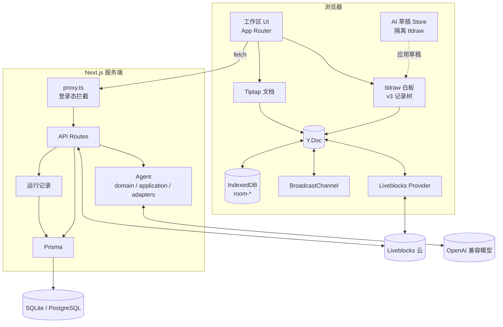
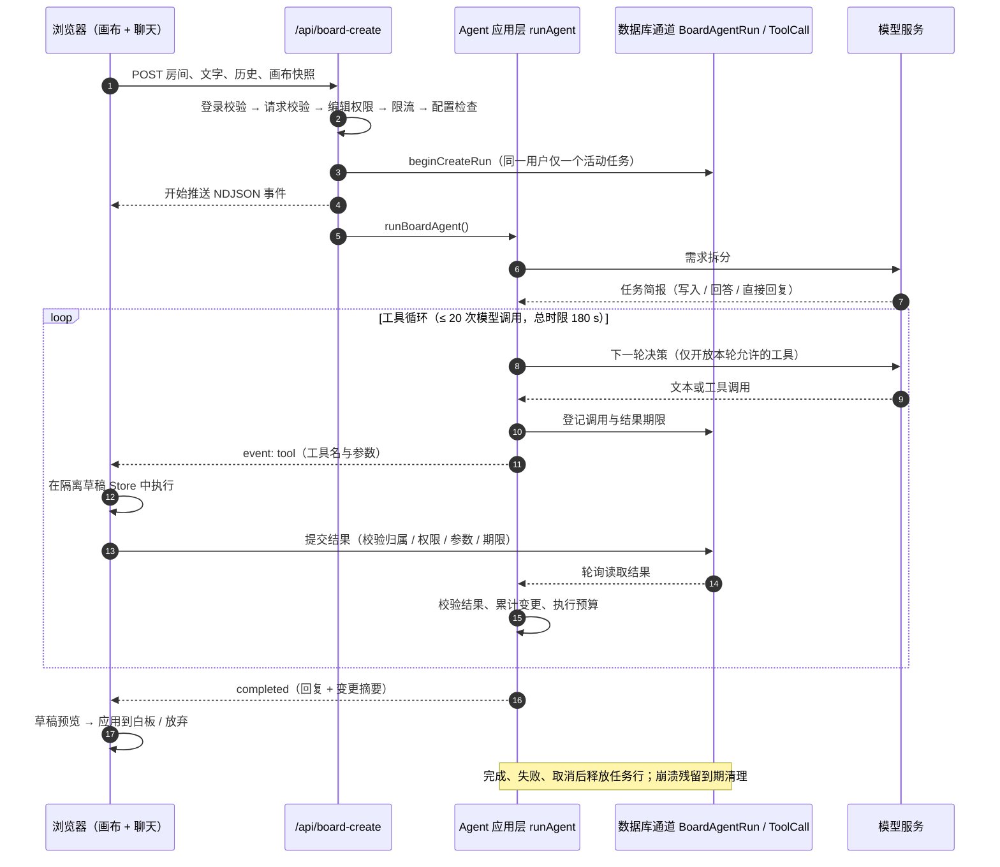

<div align="center">

# CollabAI Studio

**文档 · 无限白板 · 实时协作 · 离线优先 · AI 白板助手**

一个基于 Next.js 16、Yjs（CRDT）与 Liveblocks 的多人实时协作工作区：<br />
同一份空间里写文档、画白板，断网也能继续，AI 以「草稿」形式帮你改画布。

[](https://nextjs.org/)
[](https://react.dev/)
[](https://www.typescriptlang.org/)
[](https://yjs.dev/)
[](https://liveblocks.io/)
[](https://tldraw.dev/)
[](https://tiptap.dev/)
[](https://www.prisma.io/)

</div>

---

## 目录

- [项目简介](#项目简介)
- [功能特性](#功能特性)
- [系统架构](#系统架构)
- [AI 子系统](#ai-子系统)
- [白板协作引擎](#白板协作引擎)
- [技术栈](#技术栈)
- [项目结构](#项目结构)
- [快速开始](#快速开始)
- [环境变量](#环境变量)
- [数据库与初始化](#数据库与初始化)
- [常用脚本](#常用脚本)
- [测试与质量检查](#测试与质量检查)
- [部署](#部署)
- [已知限制](#已知限制)
- [路线图](#路线图)
- [致谢](#致谢)
- [贡献](#贡献)

---

## 项目简介

CollabAI Studio 是一个 **本地优先（Local-First）** 的协作工作台。每个「文档」同时拥有两种视图：

- **文档模式**：基于 Tiptap（ProseMirror）的富文本编辑，支持标题、列表、代码块、引用与文字样式；
- **白板模式**：基于 tldraw 的无限画布，支持图形、连线、图片与多人光标。

两种视图共享同一个房间；文档内容与白板内容都存放于 Yjs 文档中，通过 Liveblocks 在浏览器之间同步，通过 IndexedDB 在本地持久化。AI 助手在右侧抽屉中提供图文对话，并在白板模式下以**隔离草稿**的方式执行「新建 / 修改 / 删除图形」等操作，用户确认后才写入共享画布。

设计目标：

| 目标 | 实现方式 |
| --- | --- |
| 并发编辑不冲突 | Yjs CRDT，所有编辑以增量 Delta 广播 |
| 弱网 / 断网可用 | y-indexeddb 本地持久化 + 多标签页 BroadcastChannel 同步 |
| 访客零门槛 | 未登录直接进入本地工作区，数据只存在浏览器 |
| 权限可协作可只读 | owner / collaborator / viewer 三级角色，服务端签发 Liveblocks Token |
| AI 改动可控 | 模型只写隔离草稿 Store，用户「应用 / 放弃」后才触碰共享画布 |

---

## 功能特性

### 双模式编辑

- **文档模式（Tiptap 3）**
  - StarterKit：段落、H1–H3、有序 / 无序列表、代码块、引用、分割线、撤销重做；
  - TextStyle + FontFamily：字体样式扩展；
  - 多人协作：`@tiptap/extension-collaboration` 接入 Yjs，自定义 `CustomCursor` 基于 Awareness 显示协作者光标与颜色；
  - 标题防抖写回：本地 IndexedDB 与云端 `Document.title` 双写，避免高频请求；
  - viewer 角色自动切换为只读。

- **白板模式（tldraw 4）**
  - 无限画布、框选、连线、箭头、图片缩放旋转等原生交互；
  - 粘贴图片自动落盘为 asset 并插入画布；
  - 多人光标与选区（Liveblocks Presence → tldraw `instance_presence`）；
  - 中文界面与明暗主题跟随工作区设置；
  - 本地与在线两套 Store 共用同一个 tldraw × Yjs 绑定实现。

### 实时协作与权限

- GitHub OAuth 登录（NextAuth v4 + Prisma Adapter，JWT 会话）；
- 角色模型：**owner**（拥有者）、**collaborator**（合作者）、**viewer**（观众）；
- 邀请按用户 ID 添加协作者 / 观众，房间 ID 可复制分享；
- `/api/liveblocks-auth` 在服务端校验房间、角色与白板协议版本后签发 Token：
  - owner / collaborator → `FULL_ACCESS`
  - viewer / 公开房间 → `READ_ACCESS`
  - 房间默认不开放公开访问，所有授权都由服务端计算；
- 进入房间前先请求 `/api/entry-validations`，无效房间直接指向 404 页面，避免出现「空白编辑器」。

### 工作区体验

- 文档列表合并本地 IndexedDB 与云端 `Document`，按房间 ID 去重、按日期分组；
- 支持标题搜索、新建文档、通过房间 ID 加入已有协作房间；
- 响应式侧边栏：移动端为抽屉，支持 Esc 收起与焦点管理；明暗主题持久化。

### 离线优先与多端

- **本地持久化**：每个房间对应一个 `room-${roomId}` 的 IndexedDB 数据库（y-indexeddb）；
- **多标签页同步**：自研 `BroadcastChannel` Provider，按 `yjs-room-${roomId}` 广播增量并执行 `sync-step-1/2` 初始同步；
- **网络开关**：白板通过 `useNetworkStore` 控制 Liveblocks `room.connect()` / `disconnect()`；断网期间编辑照常写入 Yjs 与 IndexedDB，恢复后由 CRDT 状态向量合并；
- **落盘兜底**：白板在 `beforeunload` 时强制 `storeState`，避免刷新丢失最后的增量；
- **存储治理**：文档索引存于 IndexedDB `editor-data`；当浏览器配额使用率超过 90% 时，按 LRU 清理最近最少使用的 3 个其他房间；
- **离线初始化保护**：本地白板初始化使用 Web Locks（`board-init-${roomId}`）串行化，防止多标签页同时 bootstrap。

### 内置 AI

- 右侧 AI 助手抽屉：图文对话、粘贴图片、取消请求、清空会话；
- 白板模式下可直接用自然语言描述需求，Agent 会：
  1. 先拆分需求（任务简报）并校验；
  2. 读取画布快照 / 截图，必要时向你追问（可附图片或选中元素）；
  3. 在**隔离的草稿 Store** 中执行工具调用；
  4. 展示草稿预览与「新增 / 修改 / 删除」计数，由你决定应用还是放弃；
- 模型服务可切换 Qwen / OpenAI 兼容接口，密钥只留在服务端；
- Agent 运行记录后台：`/admin/agent-traces`，支持流程图、时间线、失败分类筛选与图片查看。

### 可观测性

- 聊天与白板任务都经过统一的运行记录包装：认证、校验、限流、模型调用、工具循环、结果回传、草稿操作均有步骤；
- 每步记录 `outcome`（待完成 / 成功 / 失败 / 取消）、`source`（server / client）、`errorCategory`、`errorCode` 与脱敏诊断；
- 浏览器只能向本人任务上报白名单操作（每任务 ≤ 32 条、每请求 ≤ 16 KiB），不能改写服务端结果；
- 模型请求保留厂商实际返回的推理内容，不生成、不补写隐藏思维链。

---

## 系统架构



### 分层说明

| 层 | 位置 | 职责 |
| --- | --- | --- |
| 页面与组件 | `src/app`、`src/components` | 工作区布局、双模式切换、编辑器、AI 抽屉、弹窗与主题 |
| 客户端状态 | `src/app/store` | Zustand：用户、文档列表、编辑器元信息、网络、界面 |
| 协作适配 | `src/utils/collaboration` | tldraw × Yjs 绑定、共享历史、v1/v2→v3 迁移、房间权限 |
| 本地存储 | `src/utils/storage` | 文档索引、LRU 清理、配额查询 |
| Agent 领域层 | `src/agent/domain` | 纯 Zod 契约：任务、元素、工具、消息、结果、错误分类 |
| Agent 应用层 | `src/agent/application` | `runAgent` 用例、端口定义、工具预算与完成校验 |
| Agent 适配层 | `src/agent/adapters` | 模型（OpenAI SDK）、白板（tldraw / 草稿 / 工具）、浏览器（流式接收 / 派发）、服务端（鉴权 / 存储）、交互（追问）、传输协议 |
| 路由层 | `src/app/api` | 请求校验、限流、流式响应、运行记录包装 |
| 服务端基础 | `src/lib` | NextAuth、Prisma、Liveblocks 房间协议、运行记录与会话 |

**关键边界**：编辑器边界始终使用原生 `TLRecord`，Yjs 只负责共享与持久化；模型协议、浏览器等待、权限来源、记录持久化都通过端口注入，领域层不依赖 tldraw、Liveblocks 或 OpenAI SDK 类型。

---

## AI 子系统

### 两条调用链

| | 对话链路 | 白板 Agent 链路 |
| --- | --- | --- |
| 入口 | `POST /api/chat` | `POST /api/board-create` + `POST /api/board-create/:runId/result` |
| 响应 | SSE 流式文本 | NDJSON 事件流（开始、计划、预览、工具、完成、错误） |
| 能力 | 多轮图文对话、附带画布快照上下文 | 需求拆分、读画布、截图、创建 / 修改 / 删除图形、追问 |
| 权限 | 需登录 | 需登录 + 在线编辑权限（owner / collaborator） + 白板模式 |
| 时限 | 60 s | 180 s |
| 上限 | 40 条消息、每条 4000 字、每条最多 3 张图、请求体 ≤ 32 MB | 见下方工具预算 |

### 白板任务时序



### 工具与预算

| 工具 | 类型 | 说明 |
| --- | --- | --- |
| `create_shapes` | 写 | 创建图形（含分组），单次最多 30 个 |
| `update_shapes` | 写 | 按真实元素 ID 修改坐标或属性 |
| `delete_shapes` | 写 | 按 ID 删除已有元素 |
| `get_board_snapshot` | 读 | 读取视口 / 页面结构快照（含元素表） |
| `get_board_screenshot` | 读 | 截取画面（需要模型具备视觉能力） |
| `ask_user` | 询问 | 一次最多 20 个可独立回答的问题，回答可带文字、图片或选中元素 |

每个任务共享一组硬预算（定义于 `src/agent/application/ports.ts`）：

| 预算 | 值 |
| --- | --- |
| 写入次数 | ≤ 3 |
| 单轮工具调用 | ≤ 6 |
| 模型调用（含拆分 / 修复） | ≤ 20 |
| 追问次数 | ≤ 3 |
| 语法修复 | ≤ 2 |
| 参数纠正 | ≤ 1 |
| 单次写入图形数 | ≤ 30 |
| 元素表长度 | ≤ 6000 字符 |
| 工具参数长度 | ≤ 10000 字符 |
| 任务总时限 | 180 s |
| 普通工具等待 | 15 s |
| 追问等待 | ≤ 120 s（服务端 +5 s 回传余量） |

完成校验不只看模型说了什么：

- **写入模式**必须真的有成功写入，且任务简报中的每个对象都被覆盖；
- **回答模式**必须真的取得用户回答；
- 存在未解决的错误或「结果未知」的写入时，任务不能标记完成；
- 语法错误的参数先尝试修复；参数校验失败才允许一次带 `retryOf` 的纠正，禁止重放已成功或结果未知的调用。

### 草稿闭环

1. 服务端只派发工具调用，真正的白板操作在浏览器里执行；
2. 浏览器用独立的 tldraw `Store` 承载草稿，官方画布保持只读，避免 AI 预览干扰协作者；
3. 「应用到白板」先比对草稿基线：目标或依赖已被协作者改动时拒绝应用；否则整批写入共享画布。共享层拒绝时恢复原画布、保留活动草稿并明确报错；
4. 「放弃草稿」或离开页面会取消请求、丢弃草稿，并把结果回写到运行记录。

### 跨实例工具结果通道

白板任务的启动请求与工具结果请求可能落到不同实例，因此调用与结果不依赖进程内存：

- `BoardAgentRun`：每个用户同一时间最多一个活动任务，带过期时间；
- `BoardAgentToolCall`：以 `(runId, callId)` 为主键，保存调用参数、结果期限与结果；
- 结果先落库再派发；校验归属、当前编辑权限、调用内容与期限；相同结果可重传确认，不同结果不能覆盖；
- 完成 / 失败 / 取消后释放临时数据，崩溃残留由后续任务启动时有界清理；
- 数据库故障时停止执行并返回 503，不降级为内存 Map。

### 运行记录后台

访问 `/admin/agent-traces`，使用独立后台密码登录（与普通用户账号无关，工作区导航不提供入口）。

- 环境变量 `ADMIN_TRACE_PASSWORD`（至少 16 字符）；Cookie 为 HttpOnly，8 小时过期，修改密码即让所有后台会话失效；
- 密码尝试共享数据库限额（每 10 分钟 20 次），写操作校验同源；
- 详情页包含可点击的执行流程图与文字时间线：用户上下文、模型请求、推理内容、工具参数 / 结果、追问答案、参数纠错、耗时；
- 支持按状态与错误类别筛选；查询接口 `GET /api/admin/agent-traces`、`GET /api/admin/agent-traces/:id`，均禁止缓存；
- 字段单值最多 65536 字符，超出保存截断预览；API Key、Cookie 等传输凭据不入库；记录中的图片单独存入 `AgentTraceImage`，经受控接口读取，单条记录图片总量上限 32 MiB；
- 首版未配置自动清理或保留期限，上线前需按业务要求安排日志保留策略。

---

## 白板协作引擎

白板是项目里最复杂的部分：tldraw 的原生 Store 与 Yjs 内存相互独立，粗暴双向绑定会导致死循环、数据丢失或撤销错乱。当前实现（格式 v3）解决了这些问题。

### 共享数据布局

| 根 | 内容 |
| --- | --- |
| `tl_records_v3` | `Y.Map<recordId, Y.Map>`，每个记录一棵稳定的嵌套 Map |
| `tl_records_meta` | 格式版本、schema、迁移基线（`legacyBaseline` / `v2Baseline`） |
| `tl_records`、`tl_records_v2` | 旧数据保留，不删除 |

- **`props` 是稳定的嵌套 `Y.Map`**：普通更新只写变化的键，不重建整棵树；
- **`placement = { parentId, x, y, rotation, index }` 是原子值**：位置与父级不会被拆开，避免半更新；
- `richText`、`segments`、`meta` 等复杂值保持原子 JSON，编解码都复制数据；
- shape / page / document / asset / binding 进入共享数据；instance、camera、selection 与 presence 不进入文档历史。

### 写入与校验

- 事务前先准备完整补丁并做整批预检，校验失败不发布部分数据，并从共享状态恢复编辑器；
- 普通字段更新只校验变化记录；新增、删除、类型或引用改变时校验完整引用图；
- 更新不存在的记录直接拒绝；需要恢复时显式创建新的共享子树；
- 远端更新不进入本机撤销栈，其引发的派生变化也不回写 Yjs。

### 撤销 / 重做语义

用户确认过的规则，代码按此实现：

- 只撤销**本编辑器会话**的操作；远端更新永远不进入本机历史；
- 一个撤销步骤只要有一处与已接收的协作者更新冲突，**整步不执行**；
- 新建后别人编辑过该图形，创建者不能靠撤销把别人的成果删掉；
- 独立字段保持独立：A 撤销移动，B 修改的颜色仍然保留；
- 删除 / 重建记录、替换父级 / asset / binding 端点同样参与身份边界检查；
- 真正执行前在克隆的 Y.Doc 中模拟该步骤并校验完整引用图，防止移除别人正在使用的父级或资源；
- 冲突步骤留在栈顶并提示，不会自动跳过它去撤销更早的步骤。

实现上由 `tldrawYjsHistory.ts` 接管整个 Editor 生命周期：停止原生 `HistoryManager` 记录器、清空其数据，把 `undo` / `redo` / `canUndo` / `canRedo` / 历史标记统一桥接到 Yjs 的 `UndoManager`；原生工具栏的计数查询通过桥接继续可用。停止重复记录不等于限制历史容量，容量与压缩是独立工作（见[已知限制](#已知限制)）。

### 版本兼容与恢复

- 新房间使用 **v3** 协议；旧在线房间（v1/v2）**只读展示**并支持导出 `.yjs` 恢复备份，不静默迁移；
- 离线转换命令：

  ```bash
  node scripts/migrate-tldraw-yjs-v3.cjs input.yjs output.yjs
  ```

  命令会校验迁移结果并拒绝覆盖已存在的输出文件；
- 迁移保留旧根与基线；重载后可检测「旧版本迟到写入」并暂停编辑，提示导出备份；
- Liveblocks 房间元数据记录 `boardProtocol`，版本不匹配时返回 409 / 503，避免新旧客户端写同一房间。

### 失败可见

- 共享写入出错时通过 Toast 提示，画布保持可恢复状态；
- 绑定失败显示同步错误页并提供恢复备份下载；
- 有被保留 / 停用的祖先记录时显示提示，说明当前视图与依赖关系；
- 权限变化时立即取消进行中的 AI 请求与草稿应用。

---

## 技术栈

| 领域 | 选型 |
| --- | --- |
| 框架 | Next.js 16.1（App Router、React Compiler）、React 19.2、TypeScript 5 |
| 文档编辑 | Tiptap 3（ProseMirror）、`@tiptap/extension-collaboration`、`@tiptap/y-tiptap` |
| 白板 | tldraw 4（`tldraw`、`@tldraw/tlschema`、`@tldraw/utils`） |
| 实时协作 | Yjs 13、Liveblocks 3（`@liveblocks/client` / `react` / `node` / `yjs`）、`y-protocols` |
| 离线存储 | `y-indexeddb`、`idb`、BroadcastChannel、Web Locks |
| 状态管理 | Zustand 5 |
| 鉴权 | NextAuth v4（GitHub OAuth、JWT）、`@auth/prisma-adapter` |
| 数据库 | Prisma 6（本地 SQLite / 生产 PostgreSQL） |
| 模型接入 | `openai` 6.49.0（Chat Completions，兼容 Qwen / OpenAI） |
| 校验 | Zod 4 |
| 样式 | Sass / SCSS Modules、`lucide-react` 图标 |
| 监控 | Vercel Analytics、Speed Insights |

---

## 项目结构

```text
collab-ai-studio/
├── prisma/
│   ├── sqlite/                 # 本地开发 schema、通道表与运行记录增量 SQL
│   └── postgres/               # 生产 schema、通道表与运行记录增量 SQL
├── scripts/                    # 通道 / 运行记录初始化、v1/v2→v3 迁移、语法修复自检
├── src/
│   ├── agent/                  # AI 白板 Agent（六边形分层）
│   │   ├── domain/             # 纯 Zod 契约：任务、元素、工具、消息、错误
│   │   ├── application/        # runAgent 用例、端口、工具预算
│   │   └── adapters/           # board / model / browser / server / interaction / transport
│   ├── app/
│   │   ├── api/                # chat、board-create、documents、liveblocks-auth、admin…
│   │   ├── admin/agent-traces/ # 运行记录控制台（流程图、时间线、筛选）
│   │   ├── workspace/          # 工作区：首页、全部文档、[workId]、@header 插槽
│   │   └── store/              # Zustand stores
│   ├── components/             # 编辑器、白板、AI 聊天、导航、弹窗、主题、Toast
│   ├── hooks/                  # Yjs Store、聊天会话、草稿会话、初始化、粘贴图片
│   ├── lib/                    # NextAuth、Prisma、Liveblocks 房间协议、运行记录
│   ├── prompts/                # 对话与白板 Agent 提示词
│   ├── utils/
│   │   ├── collaboration/      # tldraw × Yjs 绑定、历史、迁移、房间权限
│   │   ├── storage/            # IndexedDB 文档索引与 LRU 清理
│   │   ├── board/              # 画布快照与能力边界
│   │   ├── chat/               # 图片校验与流式请求
│   │   └── agent-traces/       # 运行记录客户端与错误分类
│   └── proxy.ts                # Next.js 16 请求代理：API 登录态拦截
├── tests/                      # node:test：CRDT 模型、通道、执行器
├── types/
├── next.config.ts
└── package.json
```

> `src/app/workspace/@header` 是 Next.js 并行路由插槽：默认渲染工作区顶部导航；当 `?mode=edgeless` 时切换为文档 / 白板切换器。

### 主要路由

| 路由 | 说明 |
| --- | --- |
| `/` | 首页 |
| `/workspace` | 工作区首页（最近文档、快速开始） |
| `/workspace/all` | 全部文档（搜索、新建、加入房间） |
| `/workspace/[workId]?mode=doc` | 文档模式 |
| `/workspace/[workId]?mode=edgeless` | 白板模式（AI 白板助手可用） |
| `/admin/agent-traces` | AI 运行记录后台（独立密码） |

### 主要接口

| 接口 | 方法 | 说明 |
| --- | --- | --- |
| `/api/auth/[...nextauth]` | GET / POST | GitHub 登录与回调 |
| `/api/documents` | GET / POST | 文档列表、新建文档、校验房间是否存在 |
| `/api/entry-validations` | POST | 进入房间前的角色与权限校验 |
| `/api/collaborators`、`/api/viewers` | POST | 邀请协作者 / 观众 |
| `/api/liveblocks-auth` | POST | 校验房间与角色后签发 Liveblocks Token |
| `/api/title` | GET / POST | 文档标题读写 |
| `/api/chat` | POST | AI 对话（SSE 流式） |
| `/api/board-create` | POST | 启动白板 Agent 任务（NDJSON 事件流） |
| `/api/board-create/[runId]/result` | POST | 浏览器回传工具执行结果 |
| `/api/agent-traces/[id]/events` | POST | 浏览器白名单埋点 |
| `/api/admin/agent-traces`、`/api/admin/agent-traces/[id]` | GET | 运行记录查询（后台会话） |
| `/api/admin/agent-traces/session` | POST / DELETE | 后台登录 / 退出 |

所有 `/api/*`（后台记录接口与 NextAuth 除外）都会先经过 `src/proxy.ts` 的登录态校验。

---

## 快速开始

### 环境要求

- Node.js >= 20.9（Next.js 16 的最低要求）
- npm >= 9
- 一个 GitHub OAuth App
- 一个 Liveblocks 项目（仅需服务端 Secret Key）

### 1. 安装依赖

```bash
git clone https://github.com/ClownFish7788/collab-ai-studio.git
cd collab-ai-studio
npm install
```

### 2. 配置环境变量

在项目根目录创建 `.env`（已被 `.gitignore` 忽略）：

```dotenv
AUTH_GITHUB_ID=<GitHub OAuth App Client ID>
AUTH_GITHUB_SECRET=<GitHub OAuth App Client Secret>
NEXTAUTH_URL=http://localhost:3000
NEXTAUTH_SECRET=<随机密钥>

DATABASE_URL="file:../../dev.db"
LIVEBLOCKS_SECRET_KEY=<Liveblocks Secret Key>

API_KEY=<模型服务 API Key>
BASE_URL=<OpenAI 兼容接口基础地址，不含 /chat/completions>
BASE_MODEL=<模型 ID>
# MODEL_PROVIDER=qwen   # 可选，默认 qwen；也可设为 openai
```

生成 `NEXTAUTH_SECRET`：

```bash
node -e "console.log(require('node:crypto').randomBytes(32).toString('hex'))"
```

变量完整说明见[环境变量](#环境变量)。

### 3. 初始化数据库

```bash
# 首次建表（SQLite）
npx prisma db push --schema prisma/sqlite/schema.prisma
```

### 4. 启动开发服务器

```bash
npm run dev
```

`dev` 会先执行 `board:setup:sqlite`：生成 SQLite Prisma Client，并用增量 SQL 补齐白板工具通道表（可重复执行，不删除已有数据）。

打开 <http://localhost:3000>。

### 5. 生产构建

```bash
npm run build
npm start
```

> 构建脚本按 **PostgreSQL** schema 生成 Prisma Client，部署前请确认 `POSTGRES_PRISMA_URL` / `POSTGRES_URL_NON_POOLING` 已配置；本地开发继续使用 `npm run dev` 的 SQLite 生成链。

---

## 环境变量

| 变量 | 环境 | 必填 | 说明 |
| --- | --- | --- | --- |
| `AUTH_GITHUB_ID` | 全部 | 是 | GitHub OAuth App Client ID |
| `AUTH_GITHUB_SECRET` | 全部 | 是 | GitHub OAuth App Client Secret |
| `NEXTAUTH_SECRET` | 全部 | 是 | NextAuth JWT / Cookie 签名密钥 |
| `NEXTAUTH_URL` | 全部 | 是 | 站点地址（生产填 HTTPS 域名） |
| `DATABASE_URL` | 本地 | 是 | SQLite 路径，默认 `file:../../dev.db`（相对 `prisma/sqlite`） |
| `LIVEBLOCKS_SECRET_KEY` | 全部 | 是 | Liveblocks 服务端密钥，仅服务端使用 |
| `API_KEY` | AI | 是 | 模型服务 API Key |
| `BASE_URL` | AI | 是 | OpenAI 兼容接口基础地址 |
| `BASE_MODEL` | AI | 是 | 支持 Chat Completions 的模型 ID |
| `MODEL_PROVIDER` | AI | 否 | `qwen`（默认）或 `openai` |
| `NEXT_PUBLIC_TLDRAW_LICENSE_KEY` | 全部 | 否 | tldraw 商业授权；未填时使用默认水印 |
| `ADMIN_TRACE_PASSWORD` | 后台 | 使用后台时必填 | 运行记录控制台密码，至少 16 字符 |
| `POSTGRES_PRISMA_URL` | 生产 | 生产必填 | PostgreSQL 连接串（可走连接池） |
| `POSTGRES_URL_NON_POOLING` | 生产 | 生产必填 | PostgreSQL 直连串，供 Prisma schema `directUrl` 使用 |

模型模式差异：

- `qwen`：发送 `max_tokens` 与 `enable_thinking: false`；
- `openai`：发送 `max_completion_tokens`，不发送 `enable_thinking`；
- 两条链路都关闭 SDK 自动重试，沿用请求取消信号与各自的超时；
- 白板 Agent 需要模型支持**工具调用**；读取截图或图片输入需要**视觉能力**，不要仅凭接口兼容就换成纯文本模型。

---

## 数据库与初始化

项目按环境拆分了两套 Prisma schema：

| 环境 | Schema | 数据库 |
| --- | --- | --- |
| 本地开发 | `prisma/sqlite/schema.prisma` | SQLite（`dev.db`） |
| 生产 | `prisma/postgres/schema.prisma` | PostgreSQL |

核心模型：

| 模型 | 用途 |
| --- | --- |
| `User` / `Account` / `Session` / `VerificationToken` | NextAuth 账号体系 |
| `Document` / `Collaborator` / `Viewers` | 文档、拥有者、协作者与观众 |
| `BoardAgentRun` / `BoardAgentToolCall` | 跨实例的白板任务与工具结果通道 |
| `AgentTrace` / `AgentTraceEvent` / `AgentTraceImage` | AI 运行记录 |
| `TraceAdminLogin` | 后台密码尝试限额 |

增量初始化命令（可重复执行，不重置或删除已有数据）：

```bash
# 本地 SQLite
npm run board:setup:sqlite    # 白板工具通道表
npm run trace:setup:sqlite    # 运行记录表

# 生产 PostgreSQL（由运维在目标环境执行）
npm run board:setup:postgres
npm run trace:setup:postgres
```

说明：

- 这一步只创建新增的表和索引；已有用户、白板与运行日志不会被覆盖；
- 生产首次部署前必须先完成初始化再启动应用，否则白板任务会返回「任务存储不可用」（503）；
- 仅重新部署而不建表，不会自动补表；
- 若团队需要版本化迁移历史，可在首次建表时用 `npm run prisma:migrate:sqlite -- --name init` 代替 `prisma db push`（二选一，避免两套历史同时存在）；
- Windows 上若 Prisma 生成报 `EPERM: operation not permitted, unlink ...`，先关闭占用该客户端的开发 / 测试进程后重试。

---

## 常用脚本

| 命令 | 说明 |
| --- | --- |
| `npm run dev` | 初始化 SQLite 白板通道表并启动开发服务器 |
| `npm run build` | 生成 PostgreSQL Client 并构建 |
| `npm start` | 启动生产服务器 |
| `npm run lint` | ESLint |
| `npm test` | 运行 `tests/*.test.cjs`（Node 内置测试运行器） |
| `npm run prisma:generate:sqlite` | 生成 SQLite Prisma Client |
| `npm run prisma:generate:postgres` | 生成 PostgreSQL Prisma Client |
| `npm run prisma:migrate:sqlite` | SQLite 迁移（开发用） |
| `npm run prisma:migrate:postgres` | PostgreSQL `migrate deploy` |
| `npm run board:setup:sqlite` / `:postgres` | 白板工具结果通道建表 |
| `npm run trace:setup:sqlite` / `:postgres` | 运行记录表建表 |
| `node scripts/migrate-tldraw-yjs-v3.cjs in.yjs out.yjs` | 离线把 v1/v2 白板转换为 v3 |

---

## 测试与质量检查

```bash
npm test
npx tsc --noEmit --incremental false
npx eslint <修改的文件>
```

测试使用 Node 内置 `node:test`，不连接业务数据库，也不依赖外网模型：

| 套件 | 覆盖内容 |
| --- | --- |
| `board-liveness.test.cjs` | tldraw × Yjs 模型测试：稳定记录、原子 placement、整步撤销冲突、保留 / 停用祖先、v1/v2→v3 迁移、只读旧房间、AI 正式应用与拒绝回滚 |
| `board-channel.test.cjs` | 真实跨进程结果提交、并发 / 重复提交、期限、取消、存储故障（独立 SQLite 测试库） |
| `board-executor.test.cjs` | 浏览器执行器：先登记后派发、轮询唤醒、超时不重放、非参数失败中止 |

质量检查约定：

- `npm test` 通过；
- TypeScript 无错误（增量缓存可能导致误报，使用 `--incremental false`）；
- 针对改动文件运行 ESLint。

> 自动测试使用模拟的模型 HTTP 响应，**不代表**已完成真实厂商或浏览器验收；真实 Liveblocks 多设备、角色变更、旧 Token 撤销与生产迁移仍需单独验收。

---

## 部署

以 Vercel + PostgreSQL 为例：

1. **准备数据库**：创建 PostgreSQL 实例，配置 `POSTGRES_PRISMA_URL`（连接池）与 `POSTGRES_URL_NON_POOLING`（直连）。
2. **首次初始化**：在目标环境执行 `npm run board:setup:postgres` 与 `npm run trace:setup:postgres`，确认命令指向生产库后再部署。
3. **配置环境变量**：所有模型、Liveblocks、NextAuth 密钥放在服务端变量中，不要使用 `NEXT_PUBLIC_` 前缀（tldraw 授权除外）。
4. **部署与验证**：完成一次「登录 → 新建文档 → 切白板 → AI 草稿应用」的完整闭环。

需要注意：

- Vercel Function 请求体存在 [4.5 MB 平台限制](https://vercel.com/docs/functions/limitations)，大截图或多附件可能返回 413；本项目的通道改动不扩展媒体传输能力；
- 白板任务的流式响应需要 `maxDuration = 180`，聊天路由为 `maxDuration = 60`；请确认所选套餐允许的时长；
- 数据库与函数宜部署在相近区域，并检查连接池上限与函数超时；
- 生产环境必须使用 HTTPS（后台 Cookie 与同源校验依赖它）；
- 应用流程中未实现跨实例共享限流：白板任务限流为进程内每用户每分钟 6 次，公开部署前应替换为共享存储方案。

---

## 已知限制

- **聊天不持久化**：消息仅保存在按房间挂载的组件内存中，刷新即清空；
- **任务不可续跑**：函数崩溃、页面刷新后，进行中的白板任务不会自动恢复；写入结果不明确时停止而不自动重放；
- **未实现导出**：目前只有旧格式白板的 `.yjs` 恢复备份，没有 PDF / Word / 图片导出；
- **历史容量**：停止原生历史记录器不等于限制 Yjs 历史大小，历史保留上限与文档压缩尚未实现；
- **旧白板只读**：线上 v1/v2 房间保持只读兼容，不自动迁移；生产迁移与恢复流程尚未在真实环境执行；
- **离线边界**：已登录用户「新建云端文档」仍需网络；完全离线仅保证本地工作区与已缓存房间可编辑；
- **浏览器要求**：本地白板初始化依赖 Web Locks，旧浏览器会提示更换；
- **验收边界**：真实 Liveblocks 多设备 / 角色 / 重连、旧 Token 隔离、生产 PostgreSQL 锁行为与 Vercel Preview 浏览器闭环仍需独立验收；
- **运行记录**：未配置自动清理与保留期限，共享密码仅适合小范围开发 / 运维团队。

---

## 路线图

- [ ] Yjs 历史保留上限与文档压缩
- [ ] 跨实例共享限流与任务并发治理
- [ ] 对话历史持久化与跨设备漫游
- [ ] 文档 / 白板导出（PDF、图片）
- [ ] 旧白板的受控在线迁移工具与回滚演练
- [ ] 更细粒度的权限与审计日志

---

## 致谢

感谢这些开源项目与服务的作者和维护者：

[Next.js](https://nextjs.org/) · [React](https://react.dev/) · [Yjs](https://yjs.dev/) · [Liveblocks](https://liveblocks.io/) · [tldraw](https://tldraw.dev/) · [Tiptap](https://tiptap.dev/) · [Prisma](https://www.prisma.io/) · [NextAuth.js](https://next-auth.js.org/) · [Zustand](https://zustand.docs.pmnd.rs/) · [idb](https://github.com/jakearchibald/idb) · [y-indexeddb](https://github.com/yjs/y-indexeddb)

---

## 贡献

欢迎通过 [Issues](https://github.com/ClownFish7788/collab-ai-studio/issues) 反馈问题或提交 PR。提交前请确保：

1. 改动聚焦、可独立审查，提交信息使用约定式格式（`feat:` / `fix:` / `docs:` / `refactor:` …）；
2. `npm test`、`npx tsc --noEmit --incremental false` 与改动文件 ESLint 全部通过；
3. 不提交 `.env`、`.db`、构建产物与本地记录；
4. 涉及 tldraw / Yjs 适配器的改动，请说明对共享历史、迁移与冲突语义的影响。

如果这个项目对你有帮助，欢迎 Star ⭐
