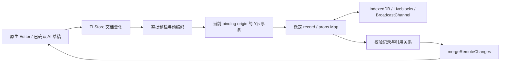

# 当前状态：2026-11-07 v3

已实现稳定记录、共享存在意图和有效依赖图，详见 [v3设计](tldraw-yjs-liveness.md) 与 [v3验收](tldraw-yjs-liveness-acceptance.md)。离线转换命令更新为 `node scripts/migrate-tldraw-yjs-v3.cjs input.yjs output.yjs`。新房间使用协议3；旧线上房间不自动迁移。

以下为此前v2方案的历史说明，接口名、格式版本和验收边界以以上v3文档为准。

---

# tldraw × Yjs 方案 A

状态：实现于独立分支 `codex/tldraw-yjs-scheme-a`，基点 `a2fe860`，2026-11-06。
新建白板已接入 v2；旧在线房间保持只读兼容，生产迁移单独执行。
验收证据见 [tldraw-yjs-acceptance.md](tldraw-yjs-acceptance.md)。

## 数据与调用链

保留 Yjs、Liveblocks、IndexedDB。编辑器边界仍使用原生 TLRecord。
共享根为 `tl_records_v2: Y.Map<recordId, Y.Map>`，旧根 `tl_records` 不删除。
每条记录的 `props` 是稳定的嵌套 Y.Map；普通更新只写变化的键，不重建整棵树。
shape 的 `placement={parentId,x,y,rotation,index}` 是一个原子 JSON 值，避免位置与父级组合被拆散。
richText、segments、meta 等复杂值保持原子 JSON，编码与解码均复制数据。
shape/page/document/asset/binding 进入共享数据，instance、camera、selection 和 presence 不进入文档撤销历史。

`bindTldrawYjs.ts` 管理 TLStore 与共享树、origin、校验和历史保护。
事务前准备完整补丁；校验失败不发布部分数据，并从共享状态恢复编辑器记录。
远端更新允许原生 session 清理，但其引发的文档派生变化不会回写 Yjs，也不会加入本机历史。
普通字段更新校验变化记录；新增、删除、类型或引用改变时检查完整图。
更新不存在的记录直接拒绝；明确恢复记录时创建新的共享子树。

## 撤销约定与实现

用户确认：只撤销本编辑器会话的操作；一个步骤只要有一处与已接收的协作者更新冲突，就整步不执行。
每个 binding 创建唯一 origin，Y.UndoManager 只追踪它；初始化、迁移、远端更新不进入历史。
不同窗口即使属于同一账号也有不同 origin；刷新后历史为空。

- 每个步骤保存其涉及单元的远端版本。位置是一个单元，颜色等 props 各自独立。
- 一个手势跨多帧合并，保留第一次修改时的版本；远端更新不会把拖动拆成多个步骤。
- A 移动、B 改颜色：A 撤销移动，B 的颜色保留。
- A 移动、B 再移动：A 的整次撤销被阻止，所有记录保持现状。
- A 新建、B 编辑该图形：A 不得通过撤销新建移除 B 的成果。
- 记录的删除/重建，以及父级、asset、binding 端点的替换，也参与身份边界检查。
- 真正执行前在克隆 Y.Doc 中模拟该步骤并校验完整引用图，防止移除别人正在使用的父级或资源。
- 一次只交给 Yjs 一个已检查步骤，避免原生 UndoManager 跳过空步骤后撤销未检查的旧步骤。

冲突步骤留在栈顶并提示用户，不会自动跳过它继续撤销更早的步骤。
undo/redo、原生工具栏、取消手势和历史标记统一经过 `tldrawYjsHistory.ts`。
2026-11-07 补充：绑定时停止原生 HistoryManager 的 Store 订阅并清空已有数据，避免重复记录。
手势标记由适配器生成；原生计数查询桥接至 Yjs 栈，创建批次结束后重新绑定缓存查询，保证工具栏响应。
适配器接管整个 Editor 生命周期，解除适配器不会重启原生记录器。当前 protected history 兼容访问针对 tldraw 4.5.3，升级依赖时需复测。
停止重复记录不等于限制 Yjs 历史容量；历史保留上限与文档压缩尚未实现。
异步图片粘贴将 asset 和 shape 一起分组，每次粘贴均有独立前后边界。
AI 预览继续使用隔离 draft store；正式应用后同步 flush，若共享层拒绝则保留 active 草稿并反馈失败。

这是对“已经接收的更新”的保护，不是分布式锁；断网时无法预知另一端尚未收到的修改。
恢复连接后的并发合并仍遵循 Yjs 规则，不能承诺离线时感知所有协作者冲突。

## 初始化、权限与兼容

本地：等待 IndexedDB 加载，在同名 Web Lock 内重新 fetchUpdates 后初始化或显式升级，再持久化和绑定。
本机旧白板先显示备份/升级入口，确认关闭其他旧窗口后才允许升级。
旧客户端不会参与新 Web Lock，因此该锁不能代替关闭旧客户端。

在线：有效缓存可只读展示；未知空缓存等待云端同步，不自行创建默认页。
已通过本房间、当前登录身份的访问校验才挂载编辑器；切换房间清除旧 role。
v2 写入还要求本会话至少获得一次 Liveblocks `canWrite` 确认，随后可离线编辑；viewer 不写共享数据。
已知 v1 缓存可离线只读显示，继续跟随旧根更新，保留 presence 和备份导出。
受控 v2 数据到达后切换绑定并重新挂载原生编辑器历史。

新在线房间顺序：创建私有 `initializing` 房间 → 写入并回读 v2 → 发布数据库记录 → metadata 放行为 `2`。
metadata 记录 bootstrap owner；同一创建者重试复用既有树，不重复播种。
回读失败且尚未尝试发布时，只清理本次新建的房间；发布或放行失败则保留供重试。
新鉴权拒绝不兼容协议及维护中的房间；它不能撤回旧客户端已经拿到的 token。

## 旧数据迁移与恢复

1. 先导出原始完整 `.yjs` 备份，并保存独立副本。
2. 在线房间必须先由运维确认旧 token/旧写入者已经隔离；本次没有自动化云端迁移或覆盖入口。
3. 离线转换：`node scripts/migrate-tldraw-yjs-v2.cjs input.yjs output.yjs`。
4. 转换器拒绝覆盖已有输出，保留所有旧根与其他共享数据，重新解码验证后才生成文件；没有云端写入。
5. 经实际服务的维护流程回读验收后再开放协议。需要回滚时恢复备份，而不是删除 v2 根假装升级未发生。

旧 Array 重复键取最右侧逻辑值，原始数据不改动。
迁移时 metadata 保存一份按 ID 排序的精确 `legacyBaseline`，以便刷新或二进制恢复后仍识别迟到的 v1 修改。
这会额外保存一份旧逻辑快照；属于恢复保护开销，不能视为数据压缩。
检测到旧写入或无效图时暂停编辑、保留上次有效视图和两套根，提供原始备份导出。
未完成升级、缺少基线或 schema 不兼容的数据不会被自动覆盖。

## 文件职责

- `src/utils/collaboration/tldrawYjsRecords.ts`：稳定树编码、字段差量与预编码。
- `src/utils/collaboration/bindTldrawYjs.ts`：共享绑定、原子写入、引用校验、撤销冲突检查。
- `src/utils/collaboration/tldrawYjsHistory.ts`：原生 Editor 历史命令与手势边界。
- `src/utils/collaboration/tldrawYjsMigration.ts`、`legacyBoard.ts`：受控初始化、转换和旧版只读投影。
- `src/hooks/useLocalYjsStore.tsx`、`useOnlineYjsStore.tsx`：持久化、连接与生命周期；在线 hook 保留 presence。
- `src/lib/boardRoomProtocol.ts`、documents/liveblocks-auth API：新房间发布顺序与协议准入。
- `src/app/workspace/[workId]/page.tsx`、`roomAccess.ts`：房间和登录身份对应的访问校验。
- `src/components/DrawEditor/`：原生编辑器接入、只读提示、恢复备份和草稿边界。

原始本地设计参考：`docs/superpowers/plans/2026-11-04-tldraw-yjs-scheme-a.md`（不随 Git 交接）；以上文档与代码为当前可交接依据。
